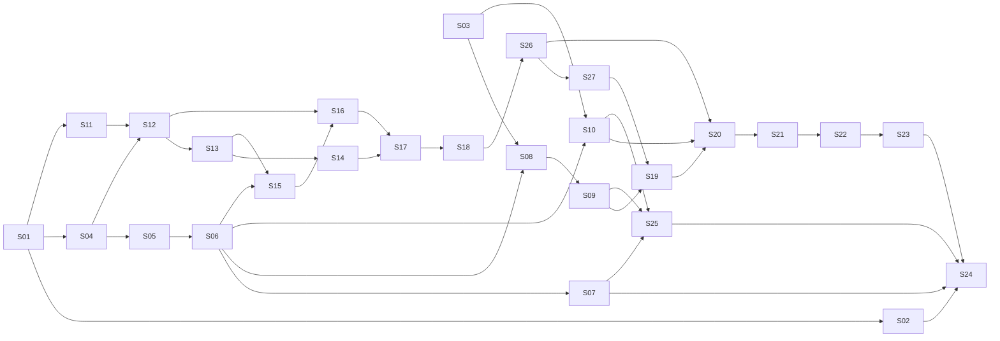

# Banana Chess for Android (native Kotlin rewrite)

## Summary
Banana Chess exists as an iPhone app and a web page, but not on Android. This plan builds a native Android app in `Android/` that plays exactly the same game: the same rules (version 18), the same four computer opponents, the same paper-and-watercolour look, and play by link that works between an Android phone and an iPhone.

## Why
The game's rules, art direction and CPU are finished and well specified, so a second platform is mostly careful translation, and it roughly doubles who can be sent a match link. The repo already holds what makes a rewrite safe: a pure rules engine with no UI in it, and a fixture of 108 complete games that any port can be checked against move for move. Doing it now, while one rules version is current across iOS and web, avoids porting a moving target.

## Approach
Port the Swift engine by hand into a pure Kotlin module and prove it against the existing 108-game conformance fixture, comparing every legal-move list, event, board, score and outcome. Add one small Swift program that emits golden data for the three things that fixture does not pin (the exact link JSON and URL, the position hashes, and the CPU evaluation) so iOS ↔ Android link play is verified against real Swift output, not inferred. Build the app in Jetpack Compose on top: one app module with feature folders, view models that own state and replay engine events, and no rule computed in the UI. Online play is by link only, using the iOS link format; nothing in this plan needs a server.

---

## Infrastructure & Backend Gaps

| Gap | Closed by |
|---|---|
| No JDK or Android SDK on this Mac | S01 |
| No Android project, lint or formatting setup | S01 |
| No Android CI | S02 |
| No golden data for the link format (payload JSON bytes, link URLs) | S03, consumed by S10 |
| No golden data for the position hashes or the CPU evaluation | S03, consumed by S08 and S10 |
| The conformance fixture's events are never checked | S05, S06 (the Kotlin harness compares them) |
| No hosted domain for `https://` links | Not closed. Out of scope; Android uses the `bananachess://` scheme, as iOS does today |

## Slices

Order of work: infrastructure → backend/data → domain/services → UI → polish. Each slice merges on its own and leaves the build green.

| ID | Title | Layer | Pts | Depends on |
|---|---|---|---|---|
| S01 | Install the Android toolchain and scaffold the Gradle project | infra | 3 | – |
| S02 | Add the Android CI workflow | infra | 1 | S01 |
| S03 | Emit golden link, key and evaluation fixtures from the Swift engine | backend | 2 | – |
| S04 | Port the engine model, opening setup, random generator and position keys | domain | 3 | S01 |
| S05 | Port the core rules: legal moves, blending, delivery, blender combat, buy-back, repetition, turn end | domain | 3 | S04 |
| S06 | Port wildcard rules, blender battles and event replay | domain | 3 | S05 |
| S07 | Port the Swift engine tests the fixture does not cover | test | 3 | S06 |
| S08 | Port the CPU evaluation | domain | 3 | S06, S03 |
| S09 | Port the CPU player and its four difficulty levels | domain | 3 | S08 |
| S10 | Port the match payload codec, match links and match authority | domain | 3 | S06, S03 |
| S11 | Build the paper-and-watercolour design system | ui | 3 | S01 |
| S12 | Draw the pieces: fruit, blenders, trays and the golden halo | ui | 3 | S11, S04 |
| S13 | Build settings storage, the Home screen and app navigation | ui | 3 | S12 |
| S14 | Build the Rules screen and the first-match teaching overlay | ui | 2 | S13 |
| S15 | Build the match view model: selection, moves, the event timeline and board accessibility text | ui | 3 | S06, S13 |
| S16 | Build the board composable | ui | 3 | S15, S12 |
| S17 | Build the Match screen and make local two-player playable end to end | ui | 3 | S16, S14 |
| S18 | Add blend bursts, splatter, piece transitions and haptics | ui | 3 | S17 |
| S19 | Add matches against the computer (plus a cancellable search, from the architecture review) | ui | 2 | S27, S09 |
| S20 | Save the match in progress and offer to resume it | ui | 2 | S19, S10, S26 |
| S21 | Add play-by-link match logic | ui | 3 | S20 |
| S22 | Wire play-by-link into Android: deep links, sharing and error alerts | ui | 2 | S21 |
| S23 | Add the app icon and a release build configuration | infra | 2 | S22 |
| S24 | Document the Android app | docs | 1 | S23, S07, S02, S25 |
| S26 | Give the app one container and make the Match route carry its source (added after the architecture review) | infra | 2 | S18 |
| S27 | Move the teaching overlay into the view model and make the match screen recompose narrowly (added after the architecture review) | ui | 2 | S26 |
| S25 | Port the Swift engine tests that needed the CPU, the evaluation or the codec (added during execution, after S07) | test | 1 | S07, S09, S10 |

**Total:** 67 points across 27 slices. No slice is larger than 3. (62 points and 24 slices when approved. Added during execution: S25 to close a gap S07 reported; S26 and S27 after an independent architecture review on 2026-11-23, which Charles asked for mid-run.)

### Dependency Graph


### Execution Waves
```
Wave 1: S01, S03  (5 pts)
Wave 2: S02, S04, S11  (7 pts)
Wave 3: S05, S12  (6 pts)
Wave 4: S06, S13  (6 pts)
Wave 5: S07, S08, S10, S14, S15  (14 pts)
Wave 6: S09, S16  (6 pts)
Wave 7: S17, S25  (4 pts)
Wave 8: S18  (3 pts)
Wave 9: S26  (2 pts)
Wave 10: S27  (2 pts)
Wave 11: S19  (2 pts)
Wave 12: S20  (2 pts)
Wave 13: S21  (3 pts)
Wave 14: S22  (2 pts)
Wave 15: S23  (2 pts)
Wave 16: S24  (1 pts)
Critical path: S01 -> S04 -> S05 -> S06 -> S15 -> S16 -> S17 -> S18 -> S26 -> S27 -> S19 -> S20 -> S21 -> S22 -> S23 -> S24  (40 pts)
```

### Blockers & Sequencing Notes
- **S01 changes this Mac, not just the repo.** It installs JDK 17 and the Android command-line SDK with Homebrew (a few GB), as Charles chose. It uses the `openjdk@17` formula, which needs no password; if any installer asks for one, the slice stops and reports.
- **S01 must look up current library versions** when it runs. The plan pins none on purpose.
- **S01 declares every dependency the plan needs**, so no later slice edits build files and UI slices cannot collide there.
- **Waves 7 to 13 are a single lane by design.** S17 through S22 each change `MatchViewModel.kt`, `MatchScreen.kt` or the navigation host. The dependencies between them are partly real sequence and partly there to keep those files from being edited concurrently. The engine and the design system run in parallel before that.
- **S23 (infra) comes after S22 (ui)**, which the validator flags as an inverted layer order. It is intended: the release configuration shares `AndroidManifest.xml` with S22 and is only worth proving once the app is feature-complete.
- **S03 needs Xcode**, which this machine has (`DEVELOPER_DIR=/Applications/Xcode-26.5.0.app/Contents/Developer`). It adds a new Swift executable and does not touch `ConformanceFixtures` or the web fixture.
- **Parallel Gradle builds** share one Gradle cache. Wave 5 runs five lanes at once; if memory pressure shows, execution can drop to three lanes without changing the plan.
- **No emulator.** Compose tests run on the JVM under Robolectric. Nothing in this plan is checked on a physical device; that first run on a real phone is Charles's to do after final review (`adb install` instructions land in S24).
- **Nothing needs an account, a key or a server.** Signing a release is deliberately left out of S23.

### Error Surfaces

| Error path | Where the user sees it, in every state | Slice |
|---|---|---|
| A link that is not a match, is damaged, is from a newer or older version, or uses incompatible rules | Alert "Can't open that match" with the specific reason, hosted at app level so it appears over Home (with or without a "Resume match" entry), over a match in progress, and over Rules; the current screen is left as it was | S21 (messages), S22 (surface) |
| A link older than the match already on this phone | Same alert: "That link is older than the match on this phone." | S21, S22 |
| The share sheet cannot open | Match screen banner: "Couldn't open the share sheet. The link was copied instead.", with the link on the clipboard; shown whether the match is in progress or finished | S22 |
| The engine refuses an action (unreachable through the UI, but possible) | Dismissible banner under the turn indicator on the Match screen while playing, while events are animating, and over the result overlay. (iOS stores this error and never shows it.) | S15 (state), S17 (surface) |
| The resume snapshot cannot be read, is corrupt, or is from another rules version | Deliberately silent: the file is deleted and Home simply has no "Resume match" button. Best-effort by design, with a comment in the code | S20 |
| The resume snapshot cannot be written | Deliberately silent: the match continues; only resume is lost | S20 |
| Settings cannot be read | Deliberately silent: defaults are used | S13 |
| The CPU finds no action | Not an error: the engine has already passed or ended the turn | S19 |

### Architecture review (2026-11-23, mid-execution)
Charles asked that the architecture meet the standard of a top-tier consumer Android team. An independent review of the code built through S17 found it would pass such a review, with one structural problem: matches were handed to the Match screen through an in-memory holder, so process death lost the match and resume and deep links would each have patched around it. Response:
- **Must fix:** route-carried match source and an `Application`-owned container (S26, before S20); effect lifetime owned by the view model and haptics that cannot leak the activity (folded into S18).
- **Should fix:** teaching overlay state moved into the view model and narrower recomposition (S27); cancellable CPU search with a stale-reply guard (folded into S19); engine JSON types kept internal (folded into S20).
- **Scale-only, deliberately not done:** feature modules, a DI framework, a domain/use-case layer, binary-compatibility checks on `:engine`, screenshot tests. Each has a trigger recorded in the review; two modules remain the right split for this app.

## Risks
- **The link format is inferred, not observed.** Swift's exact JSON bytes and Apple's compression framing are known only from documentation. S03 captures real output before S10 depends on it; a mismatch shows up as a failing golden test with a readable diff, not as a broken link in a friend's hands.
- **A subtle rules difference.** Contained by S05 and S06 (108 games, 13,829 steps, events included) and S07 (the hand-written edge cases).
- **Shared mutable state corrupting the CPU search.** Contained by immutable state types (S04) and "the search never mutates its input" tests (S05, S09).
- **The look drifting from iOS.** Compose tests cannot judge appearance. S11, S12, S16 and S18 transcribe the iOS numbers exactly, but the first honest check is Charles looking at it on a phone at final review. Expect a short polish slice afterwards.
- **CPU strength on slow phones.** The search is time-boxed, so it stays responsive but plays weaker on old hardware. Accepted; noted in S24.
- **Estimate drift.** There are no prior actuals for this repo or for Android. The 14 logged slices from other projects ran slightly under estimate overall (24 estimated, 20 actual), so the estimates here are not padded.

## Out of Scope
- Live online play: no Game Center equivalent, no Cloudflare room client, no changes to `Web/server/`.
- `https://` App Links, `assetlinks.json` and any hosted domain.
- Play Store listing, signing keys, screenshots and upload.
- An emulator, on-device instrumented tests and screenshot tests.
- Sound, dark theme, tablet and landscape layouts, localisation.
- Painted piece sprites (the drawable lookup seam is built; no art is produced).
- Fixing the iOS and Web issues found during research (resume never read on iOS, match errors never shown on iOS, the stale teaching page, stale counts in `Web/README.md`). S24 records them in `DECISIONS.md`.
- Any change to the rules, the CPU tuning or the Swift engine's behaviour.

## Definition of Done (whole plan)
- All slices `done`, each self-reviewed, merged into `feature_branch`, pushed
- Full build + test suite green on `feature_branch`: `./gradlew :engine:test :app:testDebugUnitTest :app:lintDebug ktlintCheck :app:assembleDebug`, plus `swift test` in `Engine/` and `npm test` in `Web/` unchanged
- All 108 conformance games and every golden sample pass in Kotlin
- FINAL_REVIEW.md written and reviewed with Charles; major fixes resolved
